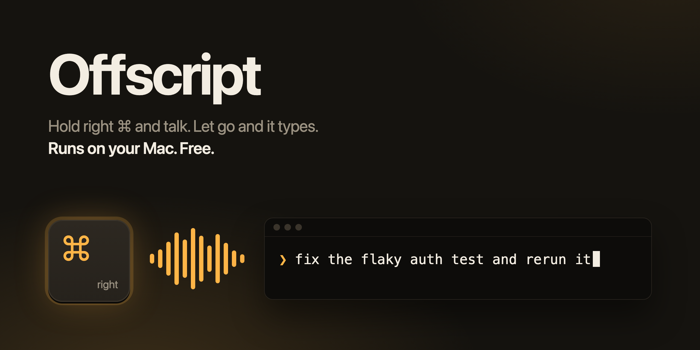

<p align="center"></p>

Offscript is push-to-talk dictation for your Mac. Hold the right Command key, say what you want, and let go. About a second later the text appears wherever your cursor is: a terminal, VS Code, Claude Code, Slack, a browser.

It runs OpenAI's Whisper large-v3 turbo model on your Mac's Neural Engine. Your voice never leaves the machine, there's no account, and it costs nothing. I built it as a free stand-in for Superwhisper and Wispr Flow, mostly for talking to coding agents.

## What it does

- **Push to talk on right Command.** A soft chime means the mic is live. A second chime means it stopped.
- **Pastes where you're typing.** Your clipboard is put back two seconds later, so whatever you had copied is still there. Passwords copied from a password manager are the exception: Offscript leaves those off the clipboard.
- **Leaves your shortcuts alone.** Right ⌘C, ⌘Tab and friends work as usual and paste nothing. A quick tap does nothing either. The mic does open for a moment when you press right Command, so you may see the orange mic dot flash.
- **Keeps your words.** Offscript removes "um" and "uh" and nothing else. No AI rewrite, so `foo()` and `args[0]` come through as you said them.
- **Spaces dictations for you.** Talk in bursts and each one lands with a space before it. Typing or clicking elsewhere resets that.
- **Lets you pick the mic.** It uses your Mac's built-in mic by default, which starts in under 100 ms. Bluetooth headsets like AirPods take 0.75 to 1.5 s to switch into headset mode.

## Requirements

- A Mac with Apple Silicon (M1 or later)
- macOS 14 Sonoma or later
- Xcode, to build it (free from the App Store)
- About 3 GB of disk for the model

## Install

```sh
git clone https://github.com/gsajith/offscript.git
cd offscript
scripts/build-app.sh
cp -R build/Offscript.app /Applications/
open /Applications/Offscript.app
```

The build script creates a local code signing certificate called "Offscript Dev" in your login keychain the first time it runs. Signing every build with the same certificate means macOS remembers your permissions when you update. If macOS asks whether codesign can use the key, click Always Allow.

## First launch

1. Allow microphone access when macOS asks.
2. Turn on Offscript in System Settings > Privacy & Security > Accessibility. It needs this to see the right Command key and to paste. No restart needed.
3. Wait for the model. Offscript downloads 1.5 GB, then macOS compiles it for the Neural Engine. On an M1 Max that took about 11 minutes in total. It happens once. Later launches are ready in a few seconds.

The menu bar icon shows where things stand:

| Icon | Meaning |
|---|---|
| ↓ arrow | Downloading or loading the model |
| Mic | Ready |
| Red mic | Recording |
| Waveform | Transcribing |
| Warning triangle | Needs attention. Open the menu to see why. |

The menu also has the microphone picker and a launch at login toggle.

## Troubleshooting

**Nothing happens when I hold right Command in Terminal or iTerm.** Turn off Secure Keyboard Entry in that app's menu. While it's on, macOS hides keystrokes from every other app, Offscript included.

**The first words get cut off.** You're probably on a Bluetooth mic. Wait for the first chime before talking, or switch to the built-in mic in the menu.

**The menu still asks for Accessibility after I turned it on.** You probably granted it to an older copy of the app. Remove Offscript from the Accessibility list with the minus button, then add `/Applications/Offscript.app` again.

**It's stuck on "Loading model…".** On the first launch that's the Neural Engine compile, which can take 10 minutes or more. If it says it failed, it retries every 30 seconds.

## Privacy

Offscript goes online for one thing: downloading the model and its tokenizer from Hugging Face on first launch. Audio, transcripts and clipboard contents stay on your Mac. Audio is held in memory only while you're dictating and is never written to disk.

## For developers

```sh
swift test                                                  # unit tests
swift build -c release
.build/release/Offscript --transcribe path/to/audio.wav     # transcribe a file and print timings
/usr/bin/log show --last 10m --predicate 'subsystem == "dev.gsajith.Offscript"' --style compact
```

The log shows how long each mic took to go live and how long each transcription took. Use the full `/usr/bin/log` path, since zsh has a built-in `log` command.

`Sources/OffscriptCore` holds the logic with tests: transcript cleanup, the push-to-talk state machine, spacing and mic choice. `Sources/Offscript` is the app itself: the key listener, mic capture, WhisperKit and the paste. Transcription runs on [WhisperKit](https://github.com/argmaxinc/WhisperKit).

## License

MIT. See [LICENSE](LICENSE).
