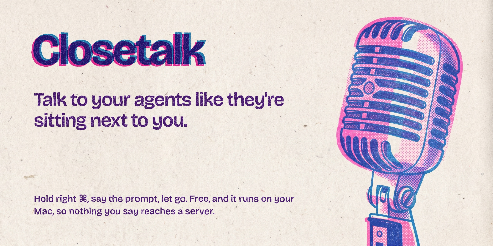

<p align="center"></p>

[Closetalk](https://closetalk.dev) ([closetalk.dev](https://closetalk.dev)) is push-to-talk dictation for your Mac. Hold a key, say what you want, and let go. About a second later the text appears wherever your cursor is: a terminal, VS Code, Claude Code, Slack, a browser.

It runs OpenAI's Whisper model on your Mac. Your voice never leaves the machine, there's no account, and it costs nothing. I built it as a free stand-in for Superwhisper and Wispr Flow, mostly for talking to coding agents.

If Closetalk saves you some typing, you can say thanks with a coffee:

[](https://ko-fi.com/Z8Z72F8S8)

## What it does

- **Chimes.** One when the mic goes live, another when it stops.
- **Keeps your words.** It removes "um" and "uh" and nothing else, so `foo()` comes through as you said it.

## Requirements

- A Mac with Apple Silicon (M1 or later)
- macOS 14 Sonoma or later
- About 3 GB of disk for the model

## Install

1. Download [Closetalk.dmg](https://github.com/gsajith/closetalk/releases/latest/download/Closetalk.dmg), open it, and drag Closetalk into the Applications folder next to it.
2. Open Closetalk from Applications. macOS asks whether you want to open an app downloaded from the internet. Click Open.

Closetalk keeps itself up to date. It checks for a new version once a day, and Check for Updates in the menu bar menu checks right away.

### Build it yourself

You'll need Xcode, free from the App Store.

```sh
git clone https://github.com/gsajith/closetalk.git
cd closetalk
scripts/build-app.sh
cp -R build/Closetalk.app /Applications/
```

The build script creates a local code signing certificate called "Closetalk Dev" in your login keychain the first time it runs. Signing every build with the same certificate means macOS remembers your permissions when you rebuild. If macOS asks whether codesign can use the key, click Always Allow.

## First launch

1. Allow microphone access when macOS asks.
2. Turn on Closetalk in System Settings > Privacy & Security > Accessibility. It needs this to notice the key you hold to talk. No restart needed.
3. Pick the key you'll hold while you talk, like fn, right ⌘ or a combo like ⌃⌥Space.
4. Wait for the model. Closetalk downloads 1.5 GB and gets it ready, which can take 10 minutes or more. It happens once. Later launches are ready in a few seconds. Meanwhile a small sample model lets you try dictation within about 30 seconds. It's less accurate, so wait for the full model before relying on it.

The menu bar icon shows where things stand:

| Icon | Meaning |
|---|---|
| ↓ arrow | Downloading or loading the model |
| Mic | Ready |
| Red mic | Recording |
| Waveform | Transcribing |
| Warning triangle | Needs attention. Open the menu to see why. |

The menu also has the microphone picker, a launch at login toggle and Check for Updates. Change dictation key… picks a different key or combo to hold.

## Troubleshooting

**Nothing happens when I hold my dictation key in Terminal or iTerm.** Turn off Secure Keyboard Entry in that app's menu. While it's on, macOS hides keystrokes from every other app, Closetalk included.

**Holding fn opens the emoji picker or starts macOS Dictation.** In System Settings > Keyboard, set "Press 🌐 key to" to Do Nothing.

**The first words get cut off.** You're probably on a Bluetooth mic. Wait for the first chime before talking, or switch to the built-in mic in the menu.

**The orange mic dot flashes when I use my dictation key for something else.** Closetalk opens the mic the moment you press your dictation key, so it doesn't miss your first word. Using it in another shortcut, or tapping it quickly, cancels the recording, and nothing gets transcribed.

**The menu still asks for Accessibility after I turned it on.** You probably granted it to an older copy of the app. Remove Closetalk from the Accessibility list with the minus button, then add `/Applications/Closetalk.app` again.

**It's stuck on "Loading model…".** On the first launch, getting the model ready can take 10 minutes or more. If it says it failed, it retries every 30 seconds.

## Privacy

Closetalk goes online for two things: downloading the speech model from Hugging Face on first launch, and checking closetalk.dev for updates once a day. The update check sends nothing about you or what you dictate. Audio, transcripts and clipboard contents stay on your Mac. Closetalk keeps audio in memory only while you're dictating and never writes it to disk.

## For developers

```sh
swift test                                                  # unit tests
swift build -c release
.build/release/Closetalk --transcribe path/to/audio.wav     # transcribe a file and print timings
/usr/bin/log show --last 10m --predicate 'subsystem == "dev.gsajith.Closetalk"' --style compact
```

The log shows how long each mic took to go live and how long each transcription took. Use the full `/usr/bin/log` path, since zsh has a built-in `log` command.

`Sources/ClosetalkCore` holds the logic with tests: transcript cleanup, the push-to-talk state machine, spacing and mic choice. `Sources/Closetalk` is the app itself: the key listener, mic capture, WhisperKit and the paste. Transcription runs on [WhisperKit](https://github.com/argmaxinc/WhisperKit).

### Notarized builds

Release builds carry a Developer ID signature and Apple's notarization, so macOS opens them without blocking. You need an Apple Developer Program membership to make one, and [uv](https://docs.astral.sh/uv/) (`brew install uv`), which runs dmgbuild to lay out the DMG window. Save your notarization login once:

```sh
xcrun notarytool store-credentials notary --apple-id <Apple ID> --team-id <Team ID>
```

To cut a release, bump `CFBundleShortVersionString` and `CFBundleVersion` in `Resources/Info.plist` through a PR. Once it's merged, run this on an up-to-date main:

```sh
scripts/release.sh <version>
```

It refuses to run on uncommitted or unpushed changes, a version that doesn't match `Info.plist`, a release that already exists, or a build number that isn't higher than the latest one in the update feed. Then it runs these, which also work one at a time:

```sh
SIGN_IDENTITY="Developer ID Application: <Name> (<Team ID>)" scripts/build-app.sh
scripts/notarize.sh
scripts/package.sh
scripts/notarize.sh build/Closetalk.dmg
```

Finally it creates a draft GitHub release with `Closetalk.dmg` and `Closetalk.zip`, then adds the update to the feed described under Updates. Review the notes, publish the release, then merge the feed change through a PR. Apple usually answers within a few minutes. If it rejects a submission, the script prints Apple's log and stops.

Self-signed builds turn off hardened runtime's library validation, because macOS only loads Sparkle.framework from the same Apple Team ID and a self-signed certificate has none. Developer ID builds keep it on.

### Updates

Closetalk checks `https://closetalk.dev/appcast.xml` once a day with [Sparkle](https://sparkle-project.org), and from Check for Updates in the menu. Sparkle installs an update only if its signature matches `SUPublicEDKey` in `Resources/Info.plist`. The matching private key lives in the login keychain.

Sparkle compares `CFBundleVersion`, not the version string, so every release needs a higher one.

The feed, `site/public/appcast.xml`, deploys with the site. Each entry downloads `Closetalk.zip` from its GitHub release, so the repo never stores app builds. `scripts/release.sh` runs Sparkle's `generate_appcast`, which signs the new zip with the key from the keychain and adds an entry for it. Publish the GitHub release before the feed change goes live, or Sparkle will offer an update it can't download.

## License

MIT. See [LICENSE](LICENSE).
